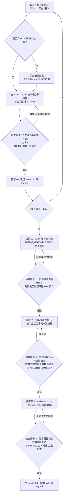

# Loop / Graph 流程設計說明（修訂版 v2）

本專案將作業流程拆為 **Phase A（Wiki 知識入庫迴圈）** 與 **Phase B（教學簡報生成與驗證圖）**。實際執行後，我們針對 PDF 解析與草稿幻覺問題調整了流程圖，新增 **Step 0（非純文字預處理）** 並將**來源與術語檢查**前置於 HTML 編譯之前。

## 流程圖（Mermaid）

## 設計解析

### 1. 哪些步驟會重複執行？
- **資料入庫外迴圈（A0 → A5）**：每處理 1 篇來源執行一次，共重複 5 次；後進資料（如第 4、5 篇）會回頭更新既有 Wiki 頁面並補充觀點衝突，而不是各自孤立。
- **局部修正內迴圈（A3→A2、B2→B1、B4→B3、B6→B5）**：每個關卡只要抓到錯誤，只重跑該節點，不影響上游已驗證的成果。

### 2. 哪些地方需要檢查或重新生成？
- **關卡 1（入庫後）**：透過人工核對＋`scripts/check_wiki.py` 檢查 YAML `sources` 欄位、斷鏈與衝突保留。
- **關卡 2（大綱後）**：檢查概念鋪陳是否由淺入深（硬體 → 傳統 → 現代 → 比較），且每頁皆綁定既有 Wiki 頁面。
- **關卡 3（草稿後）**：最核心的品質防線——檢查是否偷渡外部知識、是否把特定論文結論過度泛化、專有名詞（如 SIMD、NDC、SfM）是否附帶白話解釋。
- **關卡 4（HTML 後）**：用腳本驗證 `slides-data.js` 與 `02_Wiki/` 對應率 100%，並在瀏覽器確認互動 Canvas、鍵盤切換與無文字溢出。

### 3. 為什麼這樣設計？
將「內容資料（`slides-data.js`）」與「前端渲染引擎（`index.html`）」分離，並把內容審查提前至 Markdown 草稿階段，可避免每次修改文字都必須重寫整份 HTML，也防止排版與內容錯誤混在一起難以除錯。
